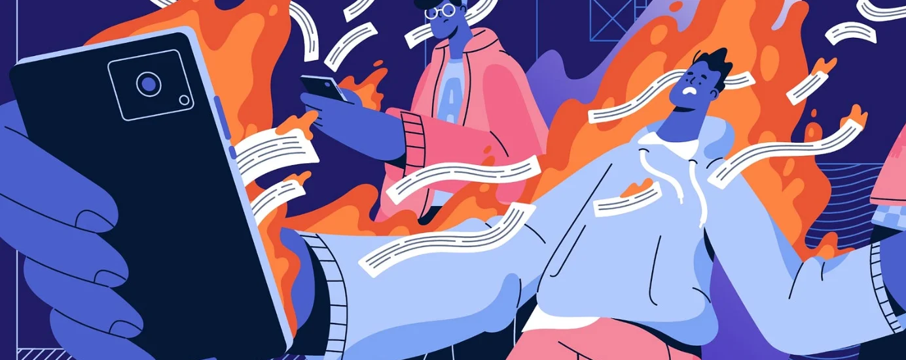
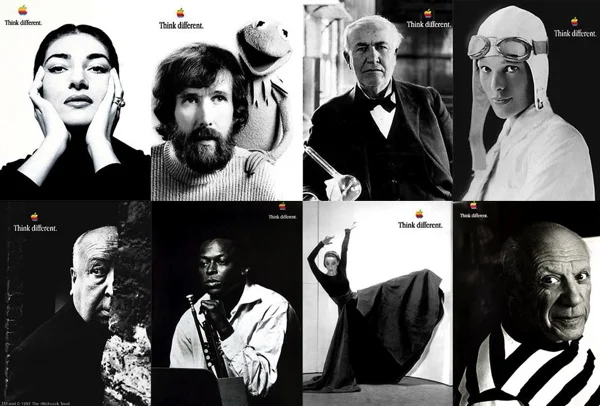
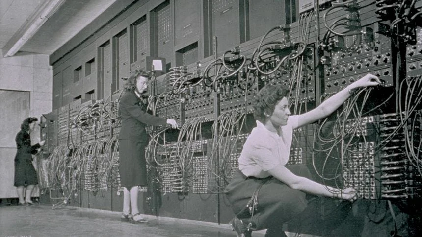
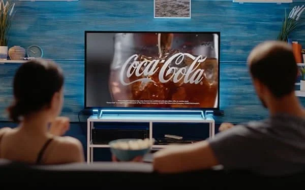
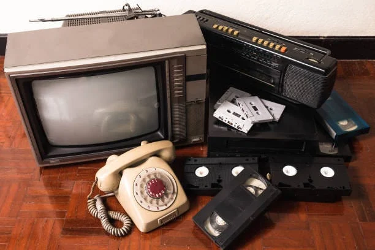
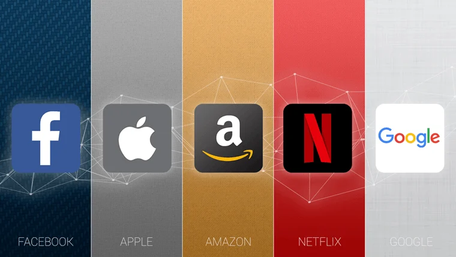

Look at the apps on your home screen right now. Ask yourself if this tool is waiting for you to use it or if it is begging you to look at it.

There has been a massive shift in how technology is built. We went from an era of **Intention**, where tech was a bicycle for the mind, to an era of **Attention**, where your focus is a natural resource to be mined and sold.

Here is how we got here, why every app feels the same, and why the “shiny object” diet is killing actual innovation.

_***“The computer is the most remarkable tool that we’ve ever come up with. It’s the equivalent of a bicycle for our minds.” — Steve Jobs (1990)***_

## 1\. The Era of Intention (When Tech Was Boring but Useful)

In the beginning, computers didn’t care if you liked them.

The early days from the mainframes to the 90s were about **utility**. You used a computer to crunch numbers, write a paper, or organise a database. You didn’t hang out in a spreadsheet just for fun. You had a specific goal, you used the tool to achieve it, and then you walked away.

Even the counter-culture boom of the 70s and 80s was driven by a desire to empower people. This was the era of the Homebrew Computer Club and the garage days of Steve Jobs. It was hippie idealism meets soldering irons.

The vibe was simple. Here is a superpower you didn’t have before. **Go build something.**

## 2\. The Shift: When You Became the Product

Somewhere along the line, the business model changed. Companies had to figure out how to pay the bills if they gave software away for free.

They borrowed the answer from TV. **Ads.**

By the mid-2000s, platforms like Facebook realised that a user who logs in, does a task, and leaves is worthless. But a user who stays for 4 hours is a goldmine.

The metric for success switched from User Utility to Time on Device.

-   **The Result:** We went from tools that respect your time to casinos that steal it.
-   **The Stat:** The average attention span has dropped to about 8 seconds, which is less than a goldfish, and we check our phones roughly 96 times a day.

We aren’t using the tools anymore. The tools are using us.

## 3\. Why Everything Looks the Same

Have you noticed that every app is morphing into the same thing?

Instagram used to be for photos, but now it is TikTok. YouTube used to be for long videos, but now it is TikTok Shorts. LinkedIn is somehow also becoming Facebook.

**Every app is just a vertical feed with an algorithm designed to keep you scrolling.**

We have processors in our pockets that would have been supercomputers in the 90s. We could be using that power to solve energy crises or cure diseases. Instead, we use that silicon to render high-def ads and filter our faces in real-time.

There is no risk anymore. In the Dot Com boom, people tried weird stuff. The iPod changed music. Online gaming created new worlds. Now we just get a slightly faster iPhone every September and a chatbot that regurgitates data.

It is a monopoly problem too. Apple and Samsung basically own the hardware. Amazon and Microsoft own the servers. When a few giants own the board, nobody wants to flip the table.

## 4\. The Shiny Object Trap

The biggest loss isn’t our attention span. It is the **next generation of builders.**

Right now, the smartest 22-year-old engineers are being trained to think that innovation means keeping people addicted to a screen.

If we feed young inventors a diet of shiny objects and dopamine hits, they won’t grow up wanting to solve hard problems like logistics, healthcare, or education. They will grow up wanting to build a better ad algorithm.

We are teaching them that **Marketing Tricks** are more important than **Real Solutions**.

## The Conclusion: Let the Pendulum Swing

We are overdue for a correction.

The 90s tech counter-culture thought the internet would free us from corporate control. Instead, it just built different cages. But the feeling is starting to shift again. You can see it in the rise of dumb phones, the privacy regulations in Europe, and the general fatigue with being online 24/7.

To get back to an era of **Intention**, we need to stop measuring success by how long we stare at a screen. We need to measure it by what we achieve when we put the phone down.

Real innovation isn’t a better feed, automating everything or a chat bot. **Real innovation is building a tool so good that you can finish your work and go outside.**
