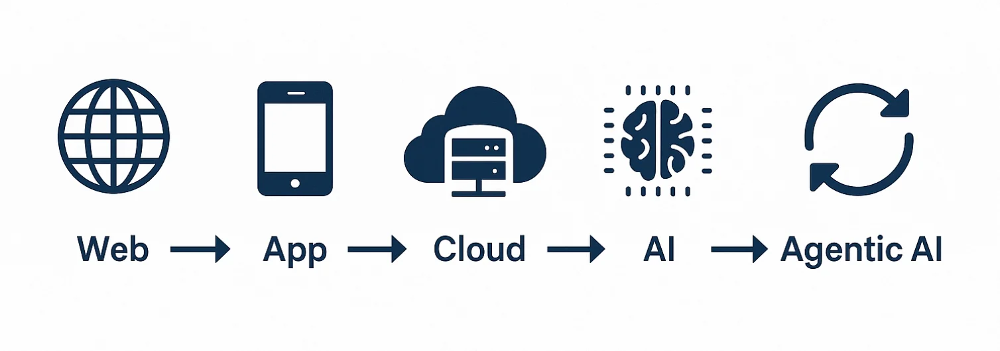
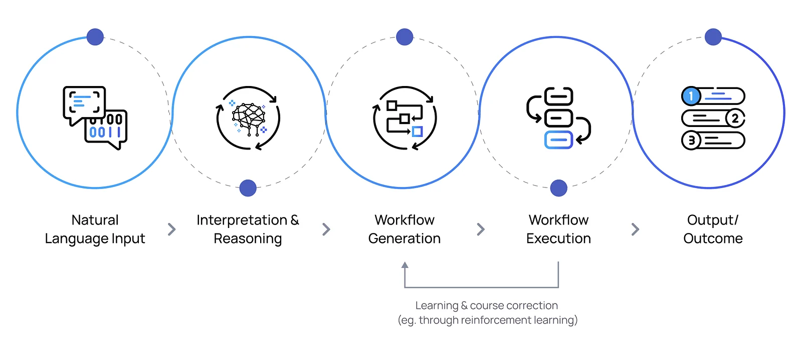
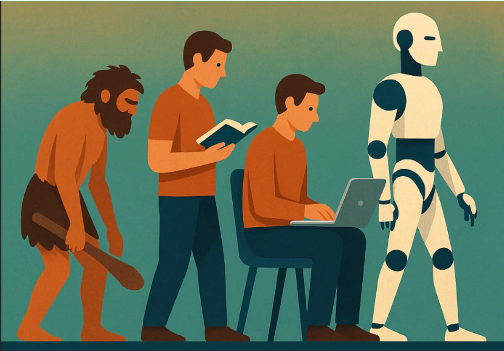

> *“The real problem is not whether machines think but whether men do.” — B.F. Skinner*

We’ve built software that listens. We’ve built software that learns. But now, for the first time, we’re building software that **does** — without waiting for us to tell it how.

_Evolution of Internet Capable Technologies_

This isn’t just a shift in capability. It’s a shift in structure. Agentic AI is the first mainstream paradigm where outcomes are emergent, not explicitly programmed. And like any system that’s both powerful and opaque, its benefits will not be distributed equally — and its risks won’t be obvious until after something breaks.

### 1\. The Myth of Smarter Tools

Adding more agents to your business won’t fix your inefficiencies — it’ll expose them. Brooks’ Law (from *The Mythical Man*) reminds us: adding manpower to a late software project makes it later. The same applies to agents. Complexity scales faster than control.

Agentic AI doesn’t eliminate the need for design. **It intensifies it**. You’re now coordinating semi-autonomous tools with their own memory, feedback, and behavior. And unless you design for drift, you will get it.

_The Fast and the Furious: Tokyo Drift (2006)_

Most builders will learn the hard way: **your first agentic workflow will fail** — because systems without constraints grow unpredictable.

### 2\. From Apps to Agents: A Systems-Level Shift

**Apps are reactive. Agents are systemic.**

Apps wait for input. You tell them what to do.  
Agents infer, plan, act — and replan. They loop.

> *“You’re not building tools anymore. You’re designing behavior.”*

### What does this mean?

In systems thinking (as introduced by Donella Meadows), a loop is a structure that creates feedback. Agents live inside loops — and they *create* them. Every observation changes what they plan. Every action changes the state of the system.

_Agentic AI Logic Flow_

Unless monitored, these feedback loops introduce instability. This is the beginning of **non-deterministic software** in mainstream use — and that demands systemic literacy, not just programming skill.

### 3\. Cognitive Load Is Shifting, Not Disappearing

**Delegation moves effort up the stack.**

You spend less time doing the thing — but more time specifying what the thing is, how it should happen, and what to do when it doesn’t.

This is what systems thinkers call *model externalization*. You can no longer rely on implicit judgment. You must expose your assumptions and expectations — and structure them into observable boundaries.

The mental work didn’t vanish. It just became structural.

### 4\. The Unfair Advantage Will Be System Design

Agentic workflows introduce an entirely new failure mode: **the right output for the wrong reasons**.

You didn’t ask for X, but the agent gave you a convincing version of it — rooted in a flawed assumption or a poorly scoped boundary. Now you’re running an operational risk with an illusion of competence.

This means: — Design prompts like you write software specs — Audit behavior, not just results — Create fallback systems and observability hooks

Think **DevOps + Product + Psychology**. Your team’s edge will not be model access. It’ll be system clarity.

### 5\. Small Builders Face a Wall They Don’t Know Exists Yet

In 2008, the App Store let anyone ship. That era is gone.

_Steve Jobs at WWDC (2008)_

Agentic AI is built on top of infrastructure that’s expensive, proprietary, and fast-moving. Fine-tuning a foundation model isn’t something you do in your bedroom.

That means the power to shape behavior is centralizing. If we’re not careful, the age of AI will be less open than the age of apps.

### 6\. How to Prepare If You’re Not a Lab or a Billionaire

### In the short term:

-   Only build agents for workflows you deeply understand
-   Use manual review steps and circuit breakers
-   Monitor not just what agents do — but *why* they did it

### In the medium term:

-   Learn how systems fail, not just how they succeed
-   Treat your prompt logic as code — version it, test it, trace it
-   Read systems theory — not just machine learning blogs

### In the long term:

-   Build internal libraries of task specs and safety scopes
-   Design for correction speed, not just first-try performance
-   Focus on understanding behaviors across time, not just in snapshot outputs

### Final Thought: This Is About Power

Every architecture distributes **power**.

The web distributed access. Apps distributed utility. Agentic AI will distribute *agency* — the capacity to act on intent.

But only if you own the design, the scaffolding, and the feedback loops.

You’re not competing on intelligence anymore. You’re competing on *delegation clarity and systemic foresight*.

> *Build accordingly — or be built around.*
