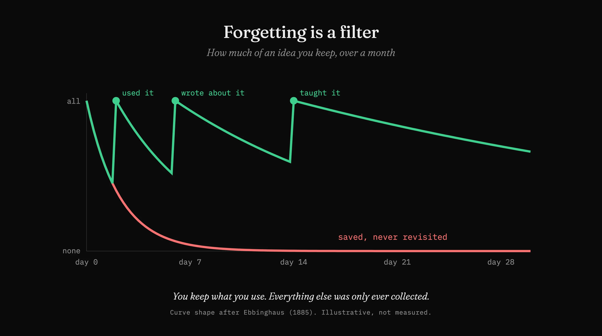

*I automated my reading so well that every highlight lands in my notes without me lifting a finger. It made me a brilliant collector. For a while, it made me a worse learner.*

## The pipeline

I have [written before](/blog/i-just-broke-my-kindle-and-it-got-way-better/) about breaking my Kindle free of Amazon. One of the things I built afterwards was a pipeline. Every passage I highlight goes straight into my notes, filed under the book, ready for later.

It works perfectly. That was the problem.

A few months in, I had hundreds of beautifully filed highlights and could not tell you what most of them said. My notes passed thirteen hundred files this year. I have read a fraction of what is in there. I have acted on less.

**I had built a very efficient machine for feeling like I was learning.**

## The collector's fallacy

In 2014 Christian Tietze, writing about note-taking, gave this a name: the collector's fallacy. The belief that gathering information is the same as knowing it. Save the article and some part of your brain files it under *dealt with*.

Everyone has a version. The reading list that grows faster than it shrinks. The podcast queue. The "read later" folder that has never once been read later. The course bought in a sale and abandoned at module two.

Even the books that sell note-taking admit it. Tiago Forte opens *Building a Second Brain* by calling most of us "information hoarders". His own method ends with a step called Express: turning what you saved into something you share, early and in small pieces. It is the step almost everyone skips. **Capturing is the fun part. Expressing is the work.**

## Why it feels so good

Collecting fires the same small rewards as learning. Something new. The sense of keeping up. The satisfaction of ticking something off.

But feeling informed is not the same as being able to do anything. Try it. How much do you remember from the last ten articles you read? How many of them changed what you actually did this week?

## The quiet cost

The bigger cost is not the time. It is what constant input does to your own thinking.

When every problem starts with "what did the experts say?", you slowly stop asking "what do I think?" You get fluent in other people's ideas and lose faith in your own. Another framework always feels more useful than going deeper into the one you have. More research always feels safer than trying something and finding out.

I wrote about a version of this in [Streaming Was Practice](/blog/streaming-was-practice/): handing your taste to a feed. Handing your thinking to a reading list is the same trick. It is just far more respectable, which makes it harder to spot.

## How Franklin learned to write

Benjamin Franklin is the cure, because he read constantly and almost never *just* read.

As a teenager he wanted to write well. So he took essays from the *Spectator*, jotted short notes on each, put the originals away, and days later tried to rewrite them from the notes alone. Then he compared his version with the original and corrected himself. Sometimes he turned an essay into verse and back again, to force himself to find new words.

He also ran a club, the Junto, where a dozen friends met every week to argue about ideas. And his famous thirteen virtues were not a philosophy he admired. They were a chart he filled in every day.

Notice the pattern. The reading is only ever the raw material. **The learning is in what he did with it.**

## Make every idea cost something

What changed things for me was not reading less, though I do. It was making every idea I keep cost me something.

Write it in your own words. Not a highlight. A sentence. If I cannot explain an idea without looking at the source, I do not have it yet. Most of the essays on this site started that way: something I read and could not stop arguing with until I had written my own version.

Use it within a week. At work, in a project, in a conversation. An idea that never meets reality is decoration.

Teach it. Standing in front of a room, you find out in about four minutes which parts of your knowledge are solid and which you have been getting by on.

Connect it. The ideas that stick are the ones that suddenly explain something in a completely different area.

## Forgetting is a filter

Hermann Ebbinghaus showed in the 1880s that we forget most new information within days unless we come back to it. We treat that as a flaw to be fixed with better systems.

I have come to think it is a filter. You do not need every detail of every book. You need the principles and the thinking tools, and to know where to look up the rest. Trying to keep everything is how you end up with thirteen hundred files and no conclusions.

So I keep less. Principles over details. The handful of ideas I actually use over the hundreds I might.

## Enough

In a world of infinite content, the hard skill is not finding information. It is knowing when you have enough to act.

There is always another article. There is always a better framework one search away. At some point the extra reading stops being research and becomes a respectable way of putting off the work.

My highlights still land in my notes every morning. The pipeline is not the problem. But I now judge a book by what I did differently afterwards, not by how many lines I saved from it.

**If your learning makes you more dependent on other people's thinking, you are collecting, not learning.** I was. The fix was not a better system. It was using the one I had.

---

*Further reading: Tiago Forte, Building a Second Brain (Atria, 2022). Christian Tietze, ["The Collector's Fallacy"](https://zettelkasten.de/posts/collectors-fallacy/) (2014). Walter Isaacson, Benjamin Franklin: An American Life (2003). Cal Newport, Digital Minimalism (Portfolio, 2019).*
