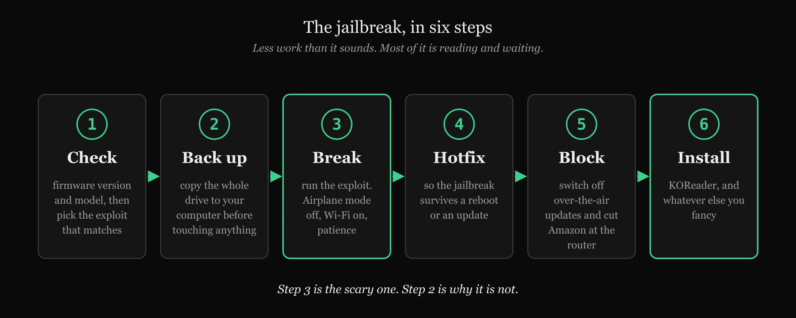
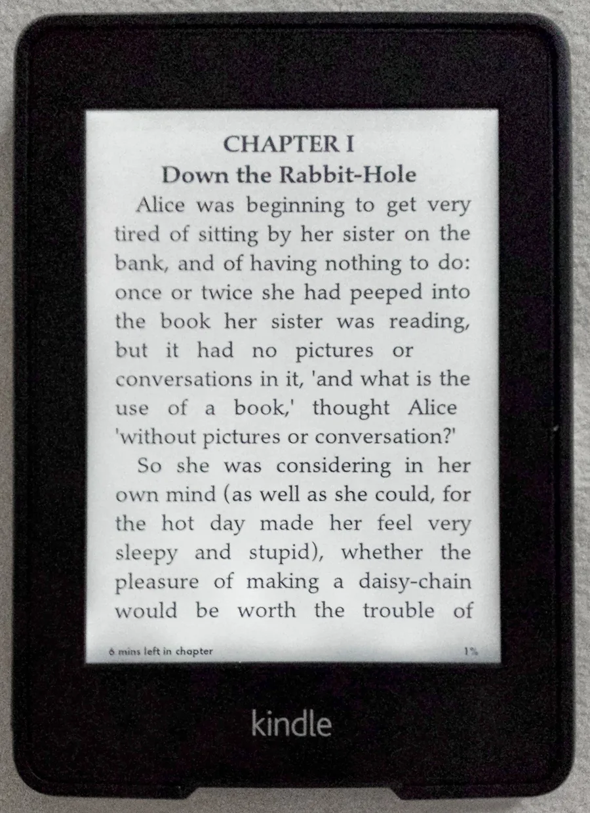
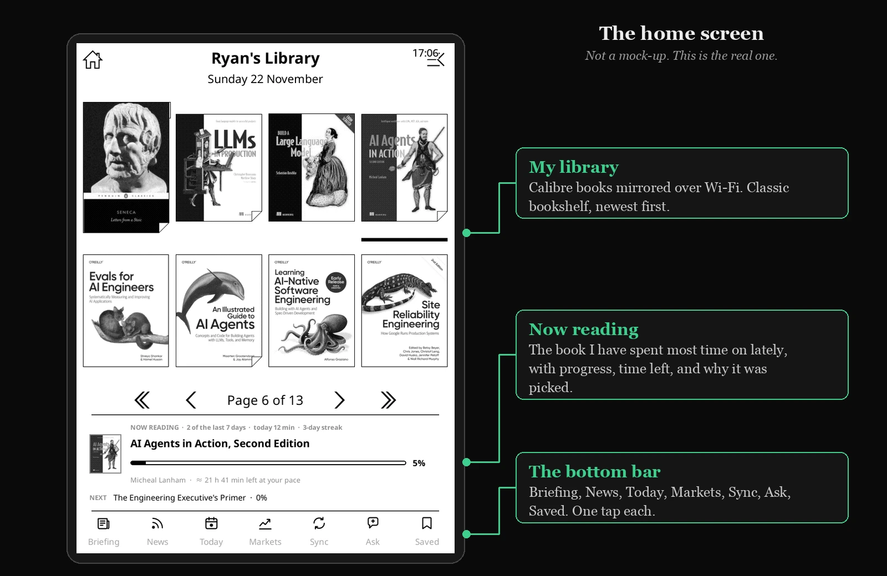
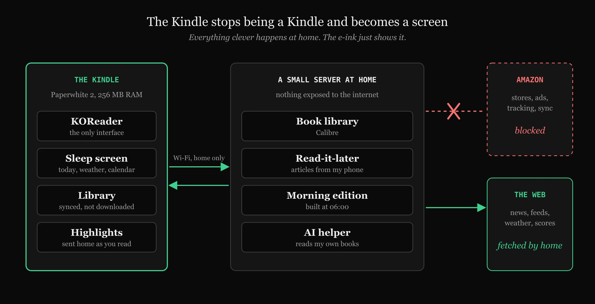
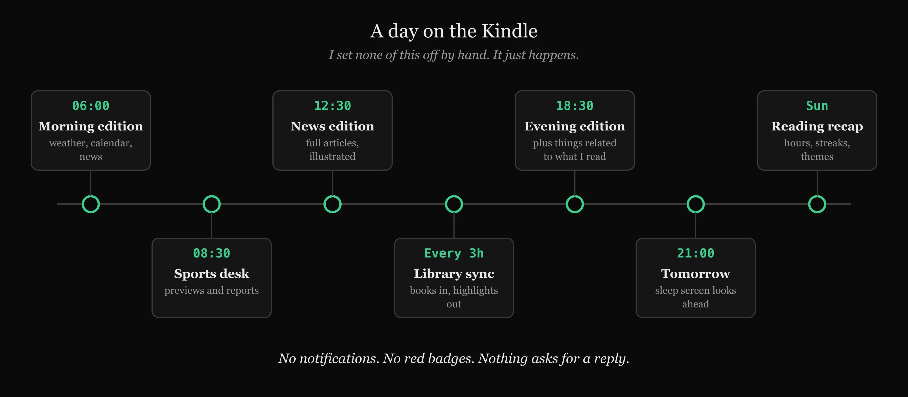
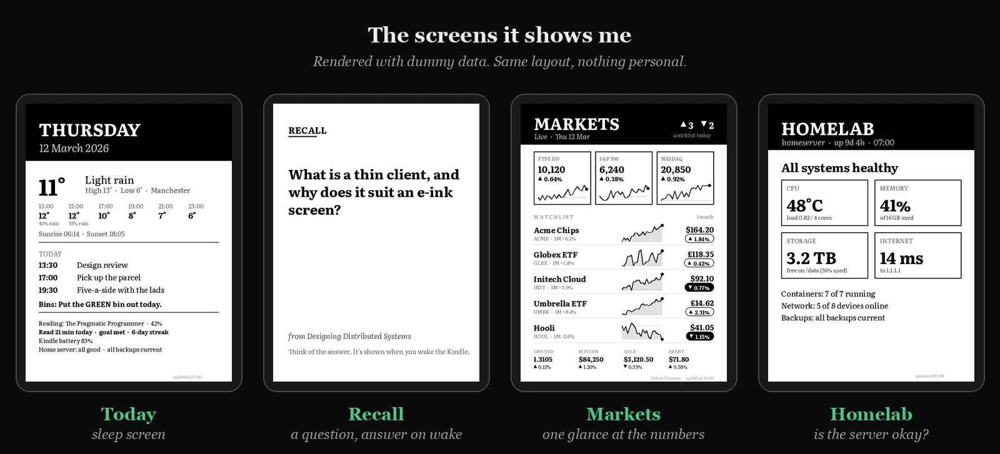
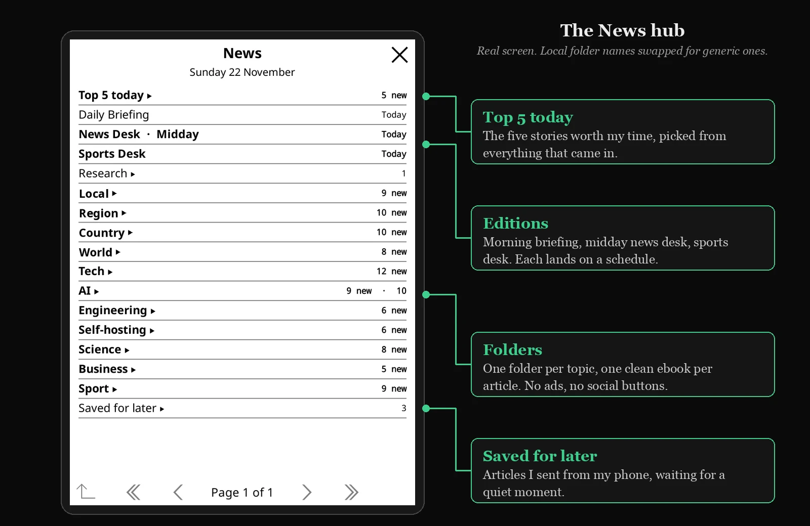

*A 2013 Paperwhite, no Amazon account, and a reading life on my own terms. Why I did it, how, and what it does for me every day.*

I broke my Kindle on purpose, and it is now the best reading device I have owned.

The polite word is **jailbreak**. It means getting around the lock a maker puts on a device so you can run your own software on it. The break itself takes minutes. The preparation decides whether you end up with a better device or an expensive coaster. So this post is part argument, part step by step, and part a tour of what I do with the thing now that it is free.

## Why bother

A Kindle is a very good screen attached to a very average shop.

The e-ink is superb. The battery lasts weeks. Your eyes survive an evening. Then you meet the rest of it: lock screen ads on the cheaper models, a store pushing itself at you, a library that only opens one door (Amazon's), and software that gets worse in the name of getting newer.

On a Kindle, a jailbreak lets you install other reading software, change what the screen does when it sleeps, and talk to servers that are not Amazon's. Nothing is removed. You are adding a door.

Here is what I got for it:

- **Any format, no conversion.** EPUB opens as EPUB. No emailing files to a Kindle address and hoping.
- **A library I own.** Books live in Calibre, a free library manager, on a small server at home. The Kindle mirrors it.
- **Reading software that respects me.** KOReader, an open source reader, has proper typography, margins I can set, dictionaries that work offline, and reading statistics I can actually query.
- **No account.** My Kindle has never been registered to Amazon. It does not know who I am and has nobody to tell.
- **Longevity.** Amazon stopped caring about this model years ago. It still runs better than it did new.

My opinion, plainly: the best Kindle feature is the absence of the store. Everything else follows from that.

## Before you touch anything

Three checks. Skip them and you are the person on a forum asking why it will not turn on.

1. **Firmware version.** Settings, Device Options, Device Info. Jailbreaks target specific versions. Newer firmware has patched the exploits, and one automatic update can close the door for good. If your Kindle is on a vulnerable version, put it in airplane mode and leave it there until you are done.
2. **Exact model.** The Paperwhite 2 and the Paperwhite 5 are different animals. The community wiki has a short [jailbreak wizard](https://kindlemodding.org/jailbreak-wizard.html) that takes your model and firmware and tells you which method to use. Use it. Mine was a Paperwhite 2 on its final firmware, which turned out to be a happy case.
3. **Your tolerance for risk.** Bricking one is rare and usually recoverable. Rare is not never. Do this to a Kindle you can live without for a week.

Amazon's terms will not love this, so read them yourself. You are modifying a device you own, and I had already decided I did not need their services.

## The steps

I am keeping this to the shape of the job, because the button presses change per model and the people who maintain the [Kindle Modding wiki](https://kindlemodding.org) keep them current. Follow them, not me, for the exact clicks. The [wiki home page](https://kindlemodding.org/) is the best starting point.

**1. Check.** Firmware and model, then pick the exploit the wizard gives you. I used [WinterBreak2](https://kindlemodding.org/jailbreaking/WinterBreak2/), a browser-based method that does not need the Kindle to be registered.

**2. Back up.** Plug the Kindle into your computer and copy the whole drive somewhere safe. The wiki has a [backup guide](https://kindlemodding.org/jailbreaking/Legacy/backing-up/backing-up.html). It takes a minute. It is the difference between a bad afternoon and a clean undo.

**3. Break.** Follow the exploit's instructions. You will need Wi-Fi at some points, which is when the Kindle might be tempted to update itself, so watch it. This is the part that feels dramatic. It is mostly waiting for progress messages.

**4. Install the [hotfix](https://kindlemodding.org/jailbreaking/Legacy/post-jailbreak/setting-up-a-hotfix/).** This is the quiet hero. It stops a reboot or update from undoing your work.

**5. Block updates.** Switch off automatic over-the-air updates as the wiki describes ([preventing auto updates](https://kindlemodding.org/jailbreaking/prevent-auto-update/)). I also block Amazon's domains for the Kindle only at the router. One catch: let `dns.kindle.com` and `s3.amazonaws.com` through. The Kindle uses them to check whether Wi-Fi works, and if you block them it insists the network is broken. I found that one the annoying way.

**6. Install KOReader.** The wiki's [KOReader guide](https://kindlemodding.org/jailbreaking/whats-next/getting-koreader/) covers the right build for your model, and the [KUAL and MRPI guide](https://kindlemodding.org/jailbreaking/Legacy/post-jailbreak/installing-kual-mrpi/) covers the launcher and package installer it relies on. Then make it launch at boot if you want the Kindle to be a KOReader device and nothing else. Keep an escape hatch to the stock screen. Mine is an empty file on the drive.

That is the jailbreak. Everything from here is the fun part.

## What I did with it

Here is where I stopped being a reader with a modded Kindle and became someone running a small publishing house for one customer.

First, the result. This is my actual home screen, untouched: my library as a bookshelf, a strip for what I am reading now, and a bar of one-tap actions along the bottom.

The Kindle is now a thin screen. Everything clever happens on a small server at home, and the Kindle only talks to that, over my own Wi-Fi. Nothing is exposed to the internet.

A **thin client** is a device that does little itself and shows what a bigger machine prepared. Mainframe terminals worked this way in the 1970s. We spent forty years moving the intelligence into every pocket, and it turns out an e-ink screen is happiest when it does not have to think.

## A day on it

The screens look like this. I rebuilt them with dummy data so you can see the layout without seeing my calendar. The real ones are drawn on the server and sent over as plain images, which is why a 2013 Kindle can show a live markets panel without breaking a sweat.

I wake up to a **morning edition** that was built at 06:00: weather, my calendar, a few things worth knowing. It is an ordinary ebook, so it opens like one, with a front page and chapters.

At midday and in the evening, **news editions** arrive: full articles, not headlines, each with one picture and no ads or social buttons. The politics filter is strict. I read the news I want and skip the part designed to make me angry.

That is the News hub. It is a real screen, apart from four local folder names I swapped for generic ones.

Articles I save on my phone turn up on the Kindle later through a read-it-later service. I stopped keeping forty browser tabs open as a to-do list.

When I highlight something, it travels home and lands in my notes. A few days later a flashcard of it shows up as my sleep screen, a question first, and the answer when I wake the Kindle. This is called **active recall**: retrieving something beats rereading it, and the Kindle does the nagging so I do not have to.

There is also an AI helper that I can ask about my own library. It answers from my books and highlights, with citations, and it is limited to reading and writing text. I use it less to get answers than to argue. I select a passage, hit "Challenge this", and it tells me where the author might be wrong.

Plug it in to charge and it becomes a small living frame: the day, a family photo, a status panel. On Sundays I get a reading recap. On New Year's Eve I get a year in books.

None of that was possible in the stock software. All of it is a few scripts and some patience.

## Where it went wrong

You came for the messy middle, so here it is.

- **Wi-Fi is flaky on a 2013 device.** Every remote job I run has retries and a timeout. The Kindle also turns its Wi-Fi off after background syncs to save battery, which is sensible and annoying in equal measure.
- **Black boot screens show every scratch on the glass.** White hides them. A small thing, but the kind of detail you only learn by living with the device.
- **Blocking Amazon too hard broke the Wi-Fi check.** See step 5.
- **A mistake in my own startup config once made a service silently vanish on every reboot**, which meant the away-from-home path quietly died. I only noticed because I went looking. Monitoring that tells you when nothing is happening is worth more than monitoring that tells you when something is.

## Should you do it

If you read a lot, own books outside Amazon's shop, and enjoy tinkering for an evening, yes. The first hour is the hard bit and the payoff lasts for years.

If you read one bestseller a month from the Kindle Store and want it to be effortless, no. A jailbroken Kindle is a small project that you maintain, and it will occasionally want attention. That is a cost, and anyone who tells you otherwise is selling you something.

What I did not expect is how much quieter reading got. No store, no recommendations, no badge, no account. The screen does the one thing it was built for.

If you try it, back up first. Then back up again.

## Links

Everything you need is on [kindlemodding.org](https://kindlemodding.org/):

- [Jailbreak wizard](https://kindlemodding.org/jailbreak-wizard.html): tells you which method fits your model and firmware
- [WinterBreak2](https://kindlemodding.org/jailbreaking/WinterBreak2/): the method I used
- [Backing up your Kindle](https://kindlemodding.org/jailbreaking/Legacy/backing-up/backing-up.html)
- [Setting up a hotfix](https://kindlemodding.org/jailbreaking/Legacy/post-jailbreak/setting-up-a-hotfix/)
- [Disabling OTA updates](https://kindlemodding.org/jailbreaking/Legacy/post-jailbreak/disable-ota.html)
- [Getting KOReader](https://kindlemodding.org/jailbreaking/whats-next/getting-koreader/)

---

*Image credits: E-reader photo by freestocks.org (CC0). Kindle Paperwhite photo (also on the cover) by Frmorrison, [Wikimedia Commons](https://commons.wikimedia.org/wiki/File:Kindle_Paperwhite_WiFi.jpg) (CC BY-SA 3.0). The Long Room, Trinity College Dublin, by Diliff, [Wikimedia Commons](https://commons.wikimedia.org/wiki/File:Long_Room_Interior,_Trinity_College_Dublin,_Ireland_-_Diliff.jpg) (CC BY-SA 4.0), cropped. Diagrams, cover and the dummy-data screens are my own. Jailbreak methods and steps: the [Kindle Modding wiki](https://kindlemodding.org/).*
