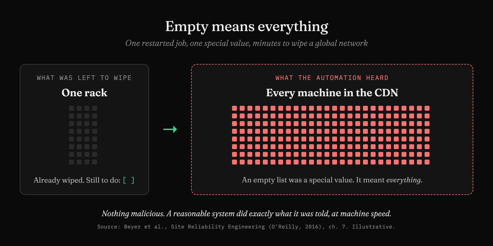
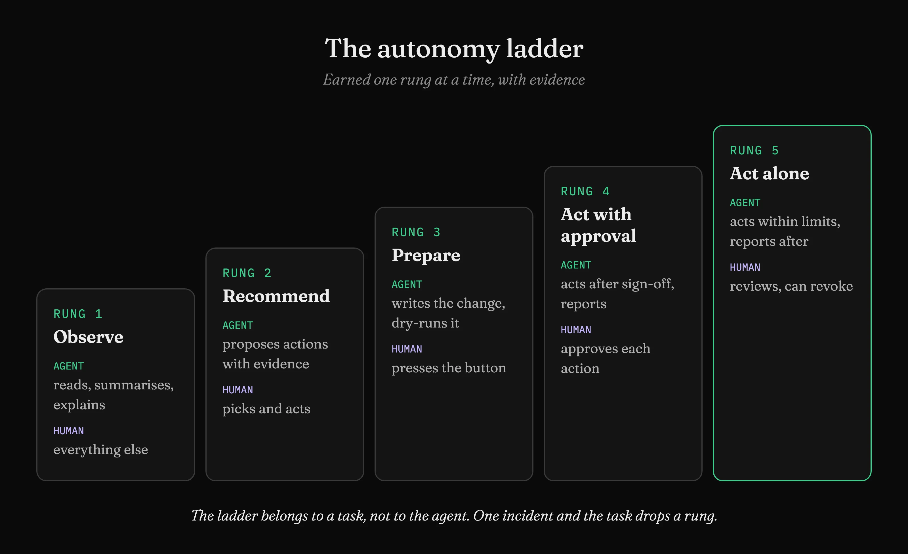

*An empty list once told Google's automation to wipe almost every machine in its content network. It did, in minutes. AI agents need a graduated licence before they get the keys.*

## Empty means everything

Google retires old racks of servers with automation. One step wipes every disk in the rack. They call it Diskerase.

One day a decommission failed halfway, after the wipe had already finished. An engineer restarted it from the top to see what went wrong. The automation asked which machines still needed wiping. The correct answer was none.

But somewhere in the code, an empty list was a special value. It meant *everything*.

Within minutes, almost every machine in Google's content delivery network around the world had its disks wiped. Users barely noticed, thanks to good capacity planning. The team spent the best part of two days reinstalling machines, then weeks adding sanity checks and rate limits.

The story is in Google's *Site Reliability Engineering* book, under a heading that should be on a poster in every AI team's office: "Automation: Enabling Failure at Scale".

Nothing in it was malicious. A reasonable system did exactly what it was told, at machine speed, with nothing to stop it doing too much. **Swap the script for an AI agent with tools and you have the whole risk in one paragraph.**

## R plates

When I explain this to people, I usually reach for a self-driving car. Closer to home there is a better analogy.

Pass your driving test in Northern Ireland and you do not get the full road. Since October 2026 you get a graduated licence: two years on R plates, with the tightest rules in the first six months, easing as you go. Nobody takes it as an insult. Passing a test proves you can drive. It does not prove you can drive at night, in the rain, with a car full of mates.

Most teams give their agents the motorway on day one.

## Two ways to crash

When an agent gets wired into real tooling, how much it may do is usually decided by whoever set it up, on the day they set it up. You get one of two failures.

The agent that needs approval for everything. Every summary, every lookup, every suggestion waits for a human. Within a fortnight nobody reads the requests. Within a month nobody uses the agent. All of the cost, none of the benefit.

Or the agent that needs approval for nothing. Brilliant in the demo. Then one day it does exactly what it was told in a situation nobody imagined, and you find out what blast radius means.

Same mistake both times. **Autonomy is not a setting on the agent. It is a decision about each thing the agent might do.**

## The ladder

The vocabulary I use has five rungs:

1. **Observe.** Read, summarise, explain. A human does everything else.
2. **Recommend.** Propose actions with evidence. A human picks and acts.
3. **Prepare.** Write the exact change and dry-run it. A human presses the button.
4. **Act with approval.** Do it after sign-off on that one action, then report.
5. **Act alone.** Do it within agreed limits and report afterwards. A human can revoke it.

The ladder attaches to a task, not to the agent. The same agent can rerun a failed overnight job on its own and still need a human to drain a queue, because one is easy to undo and the other is not. A new driver is not a restricted person. They are a person with restrictions, on certain roads, for now.

I was pleased to find Google landing on the same shape. The 2026 second edition of its SRE book has a chapter on AI in operations with a five-level model from manual to fully autonomous, defined by which steps the machine handles: monitor, investigate, approve, act, self-direct. In its own words, adopting AI in operations "is not a binary switch".

## Earning the next rung

Promotion should be boring. A task moves up one rung when, over a set period, its proposed actions were approved unchanged almost every time (95% is my bar), sampled reviews found nothing unsafe, the action can be undone and its blast radius is written down, and the dry run and the rollback have both actually been used.

"It has been fine so far" does not count. Neither does "the vendor says it is safe". An anecdote is not a measurement.

Demotion is the opposite of boring. Any incident caused or made worse by the agent drops that task a rung immediately. Not after a meeting. Immediately.

Google has a neat twist on this. An error budget is the amount of unreliability a service is allowed before it must stop shipping changes. Google ties its AI to it: spend the budget and the AI drops from acting to advising until the service recovers. **Trust is not a certificate. It moves with the health of the thing it is trusted with.**

## The button nobody reads

A good approval request shows three things: what will change, what the dry run showed, and how to undo it. Google's book adds two more the agent owes you. Its reasoning, with how confident it is. And an understanding of context, because a command that is harmless on a quiet Tuesday morning can be a disaster in the middle of a traffic peak.

Requests should expire. An unanswered request is a no. And nothing serious should be approvable in bulk. The moment you can approve twenty actions with one click, you have built a rubber stamp with extra steps.

Here is the counterintuitive bit. **More gates can make you less safe.** Ask someone to press a button forty times a day and they stop reading. They press it the forty-first time without looking, and the forty-first is the one that mattered. Keep the serious gates rare enough to be taken seriously.

## The off switch

Two cheap bits of insurance belong in every design.

A kill switch. One setting removes an agent's write access. Another stops every agent at once. You should be able to flip it from your phone in the middle of an incident.

And separate identities. Every agent runs as its own account with the least access it needs. No borrowing an engineer's credentials. When something goes wrong, the logs should name the agent, not someone's laptop.

## Off the plates

None of this is anti-agent. The point of R plates is to get you off them. Two years of evidence and you drive like everyone else.

That is the deal I would offer any agent. Read freely from day one. Recommend as soon as the recommendations are good. Act alone where you have proved, with numbers, that you get it right and that a mistake can be undone.

Earn the road. Crash, and the plates go back on.

---

*Further reading: Betsy Beyer et al. (eds.), Site Reliability Engineering, 2nd edition (O'Reilly, 2026), chapter 21, "How AI Supports SRE". Betsy Beyer et al. (eds.), [Site Reliability Engineering](https://sre.google/sre-book/automation-at-google/) (O'Reilly, 2016), chapter 7. Michael Albada, Building Applications with AI Agents (O'Reilly, 2025). nidirect, Graduated Driver Licensing (2026).*
