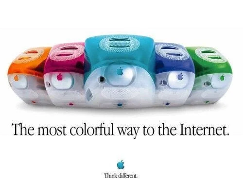
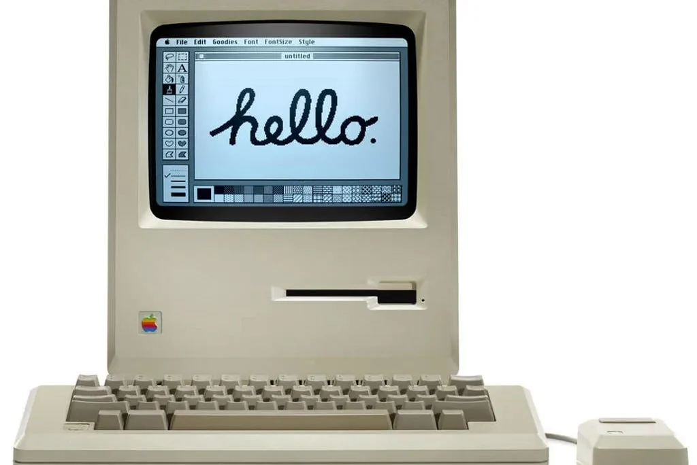

What was the first technology that made you **wow**, it likely wasn’t the app you use to check your bank. When asking yourself this question, you are likely to have a moment where you felt, i want that.

That was how I felt about both the iPod Classic & iMac. That translucent, colour that looked nothing like the beige boxes cluttering every office? It wasn’t the fastest computer you could buy. It wasn’t the **most powerful**. It couldn’t even run half the software that “*serious*” computers could. But something about it made you ***want*** it.

That’s the thing about technology’s greatest moments — they’ve never really been about the technology at all. They’ve been about how that technology made us feel, how it fit into our lives, how it solved problems we didn’t even know we had. Yet somehow, we’ve forgotten this lesson. We’re drowning in a sea of benchmark scores and feature lists, competing over marginal improvements that most of us can’t even notice.

And now, as **AI reshapes everything around us**, we’re at a crossroads. Do we repeat the mistakes of modern tech, building systems that **impress investors** more than they **help humans?** Or *do we remember what made technology magic* for anyone from a coder to a musician.

### When Design Beat Specs (And Why We Loved It)

### 1984: The Mac That Smiled Back

It’s 1984, and computers are these intimidating, beige monuments to productivity. IBM PCs dominate offices with their serious black screens and cryptic commands. Then Apple rolls out the Macintosh and it has a *face*. A little smiling computer that seemed to say “hello”.

Steve Jobs wasn’t trying to build the fastest computer. He wanted to build one that felt like a companion(R2-D2). People didn’t buy Macs because they crunched numbers faster, they bought them because using one felt *good*.
