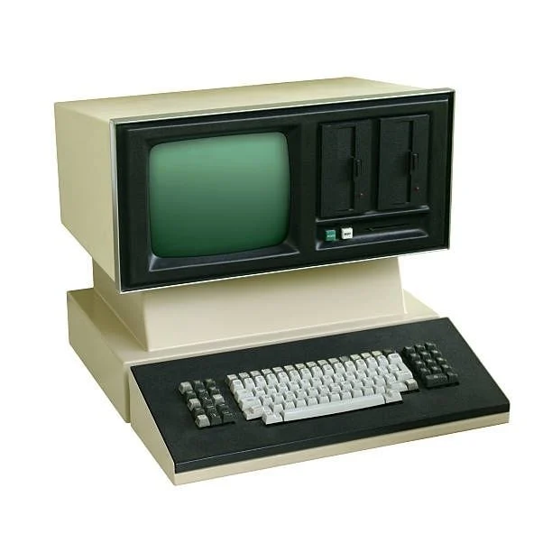
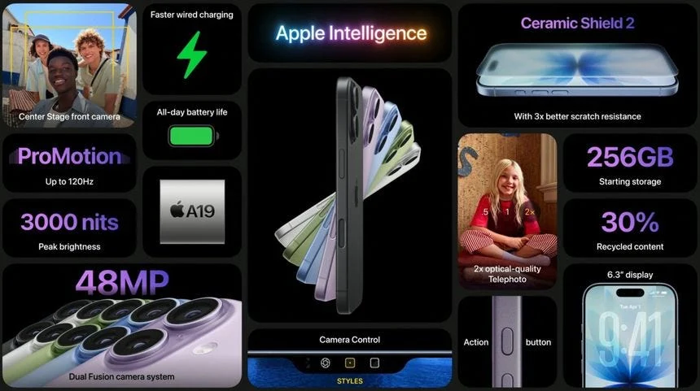

*What was the first piece of technology that made you say wow? It probably wasn't the app you use to check your bank balance.*

## I want that

Think about it for a second. Somewhere in your memory there is a moment when you saw a piece of technology and thought, plainly, *I want that*.

For me it was the iPod Classic and the iMac. That translucent, coloured plastic looked nothing like the beige boxes cluttering every office. The iMac was not the fastest computer you could buy. It was not the most powerful. It could not even run half the software that "serious" computers could. But something about it made you want it.

That is the thing about technology's best moments. They have never really been about the technology. They have been about how it made us feel, how it fitted into our lives, and how it solved problems we did not know we had.

Somewhere along the way we forgot that. We are surrounded by benchmark scores and feature lists, competing over improvements most people cannot notice. And now, with AI reshaping everything, we are about to make the same mistake at a much bigger scale.

## 1984: the computer that said hello

It is 1984, and computers are intimidating, beige monuments to productivity. IBM PCs dominate offices with black screens and cryptic commands you have to learn before the machine will do anything at all.

Then Apple releases the Macintosh, and it has a face: a little smiling computer on the screen when you switch it on. At its launch, as Walter Isaacson recounts in his biography of Jobs, it became the first computer to introduce itself. "Hello. I'm Macintosh. It sure is great to get out of that bag," it said, in a wobbly synthesised voice, before adding a maxim it claimed to have thought of on meeting an IBM mainframe: "Never trust a computer you can't lift." In the adverts the word "hello" was written across the screen in a looping script.

Steve Jobs was not trying to build the fastest computer. He wanted one that felt like a companion, something closer to R2-D2 than to a filing cabinet. People did not buy Macs because they crunched numbers faster. They bought them because using one felt good, and because for the first time a computer seemed to be built around the person sitting in front of it.

## 1998: the computer you could see into

Fourteen years later Apple was nearly bankrupt, and it came back with a computer you could see inside.

The iMac G3 came in translucent "Bondi blue" plastic, named after the colour of the water at a beach in Australia, and later in a row of fruit colours. It dropped the floppy drive at a time when that seemed reckless. It had a handle on top, which was not really for carrying it.

Jony Ive explained the handle to Isaacson. People back then were not comfortable with technology, he said, and if you are scared of something you will not touch it. A handle "gives you permission to touch". It was expensive to make, and at the old Apple the engineers would have won the argument. Jobs saw it and said it was cool. That handle is the whole thesis of this essay in one piece of plastic.

On paper it was ordinary. In a shop, next to a wall of beige towers, it looked like it had arrived from somewhere friendlier. It sold in huge numbers to people who had never owned a computer, because for the first time one looked like it belonged in a home rather than an office.

Then came the iPod: a thousand songs in your pocket, and a wheel you could use without looking. I have written about what the iPod did to how we listened to music in [Streaming Was Practice](/blog/streaming-was-practice/). The short version is that it made choosing feel good.

## The megahertz myth

In 2001 Apple went on stage to explain what it called the "megahertz myth". The whole industry was selling computers on a single number, clock speed, and Apple's argument was that the number did not tell you how fast a computer felt to use.

It was partly marketing, of course. Apple's chips had lower numbers. But the underlying point was right, and it has come round again.

Phones are sold on megapixels and benchmark results. AI models are launched with leaderboards: who scored highest on which exam, by a fraction of a point. Those numbers measure something real. They just do not measure the thing people actually experience, which is whether the tool helps them, fits into their day and can be trusted.

## What human AI would look like

AI is at the crossroads the personal computer stood at in 1984. We can keep building systems that impress investors and top leaderboards, or we can remember what made technology feel like magic, whether you are a coder or a musician.

If I had to describe AI built the human way, it would look something like this.

**It admits what it does not know.** A tool that says "I'm not sure" when it is not sure is worth more than one that is brilliant nine times and confidently wrong the tenth. Trust is a feature.

**It fits around your life, not the other way round.** It works inside the things you already use, in plain language, without a manual. The Mac did not ask you to learn commands. Good AI should not ask you to learn prompt tricks.

**It gives you your time back.** The test of a good tool is not how long you spend with it. It is how quickly you can finish what you came to do and go and do something else. I wrote more about this in [Attention vs. Intention](/blog/attention-vs-intention-how-we-lost-the-plot/).

**It is built with people, not just for them.** The best products came from someone obsessing over what it felt like to use them. AI needs the same obsession about what it feels like to depend on it.

## Wow

The technology we remember was never the fastest. It was the thing that made us say wow, and then quietly became part of how we lived.

AI will be no different. Twenty years from now, nobody will remember which model topped which leaderboard in which month. They will remember the first time one of these systems made their life simpler, didn't waste their time, and was honest when it couldn't help.

That is the bar. Not the benchmark. The wow.

---

*Further reading: Walter Isaacson, Steve Jobs (Simon & Schuster, 2011). Michael Hiltzik, Dealers of Lightning (HarperBusiness, 1999), on Xerox PARC, where the ideas behind the Mac's interface were born. Don Norman, The Design of Everyday Things (2013).*
