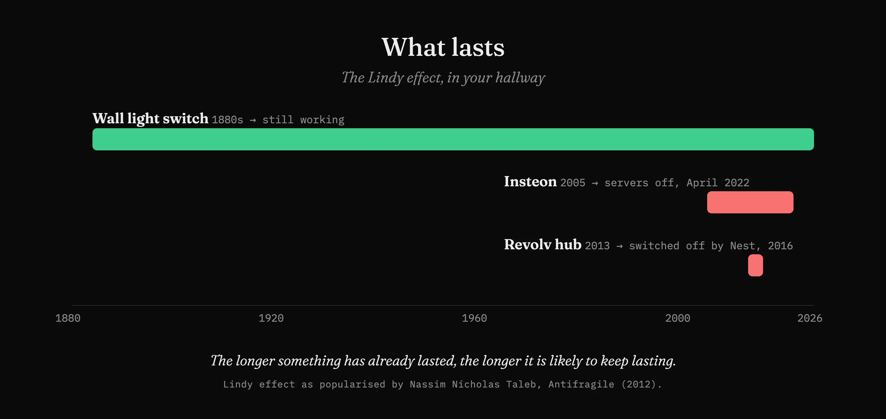

*A light switch has worked the same way for more than a century. The smart home promised to make life simpler. Mostly it put an app, a hub and a subscription between you and the lights.*

## The guest test

Here is a test for any smart home. Can a guest turn the lights off?

Not you, with your muscle memory of which app does what. A guest. Someone who walks into the room and reaches for the wall, the way people have reached for walls since electric light arrived.

In too many smart homes the answer is no. The switch is taped over. Or it cuts power to a bulb that now needs the app to come back on. Or it only works if you remember the hallway is on a different system from the kitchen. The owner explains which exact phrase the speaker responds to. The guest gives up and sits in the dark.

**That is the whole problem in miniature. The technology was meant to remove effort. It moved the effort into your head.**

## The gulf

Every device you add comes with a little manual you carry around in your head. How this app works. Which hub this bulb talks to. Which automations are reliable and which fire at random. What to say to which speaker.

Don Norman, whose *The Design of Everyday Things* should be compulsory for anyone who makes products, called the distance between what you want and what you have to do to get it the gulf of execution. A light switch barely has one. You want light. You press the thing on the wall.

A patchwork smart home widens the gulf with every gadget. You want light, so you open the app, check you are in the right home, find the right room and hope the hub is awake. None of that is in the advert. It shows up as a low, constant hum of thinking about your house instead of living in it.

## Almost reliable

A switch works essentially every time. A smart bulb works most of the time.

That gap sounds tiny until you live with it. When something basic becomes unpredictable, you stop trusting it. The first time the lights ignore you as guests arrive, or the heating ignores its schedule on the coldest night of the year, you start checking. "Set it and forget it" becomes "set it and keep an eye on it".

And every automation adds another way to fail. Rules depending on rules. Devices depending on hubs. Hubs depending on someone else's servers.

## Your lights, their servers

Then there is the failure you cannot fix: the company changing its mind.

In 2016 Google's Nest switched off the servers behind the Revolv smart home hub. The hubs, which people had paid for, simply stopped working. In 2022 Insteon, a smart home company with a loyal following, shut down with almost no warning. Customers woke up to light switches and sensors that no longer did anything.

It is the lesson that runs through everything on this site, in its most physical form. **If your lights need someone else's server to switch on, you do not own your lights. You rent them, and the landlord can leave.**

## What is worth automating

None of this means rip it all out. Some automation genuinely takes work off your plate. The test is whether it removes a decision or adds one.

The things that pass tend to be things you would otherwise forget or never notice. Safety: smoke, leaks, a door left open, with alerts tuned so you do not learn to ignore them. Comfort in the background: heating that follows a sensible schedule without being told every morning. Waste: lights and devices that turn off when nobody is there, quietly.

Everything else, the scenes, the voice routines, the twelve shades of white, should clear a much higher bar. Not "is this cool?" but "will I think about my house less once this is in?"

## Local first, switch always

Two rules make the rest of it bearable.

Keep control local where you can. Open standards like Matter, and self-hosted controllers like Home Assistant, let devices talk to each other on your own network instead of through a company's cloud. If the company disappears, your house keeps working.

And keep the switch. Whatever you automate, the physical control should still do the obvious thing. The clever layer should sit on top of the dumb one, not replace it. When the clever part fails, and it will, the house should fall back to working like a house.

## The Lindy test

Nassim Nicholas Taleb popularised a rule of thumb in *Antifragile* called the Lindy effect: the longer something has already lasted, the longer it is likely to keep lasting. The wall switch is more than a century old and will probably outlive every hub on the market. Voice assistants are still proving themselves. A touchscreen that is now the only way to turn on your kitchen lights is a bet against a hundred years of evidence.

I am not against clever houses. I broke my Kindle free and made it smarter, after all. But that worked because it runs on my terms, and it still turns pages when everything else is down.

The best smart home is one you almost never have to think about.

And the guest can still turn the lights off.

---

*Further reading: Don Norman, The Design of Everyday Things (revised edition, Basic Books, 2013). Nassim Nicholas Taleb, Antifragile (2012). Tim Wu, The Master Switch (2010). Connectivity Standards Alliance, [Matter](https://csa-iot.org/all-solutions/matter/).*
