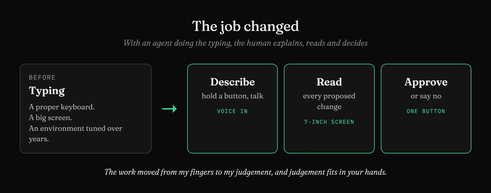

*A Steam Deck makes a poor laptop. It turns out to make a very good terminal for an AI coding agent, because the job has changed.*

## A games console with a secret

The Steam Deck is sold as a games console you can hold. Underneath, it is a full Linux computer. Hold the power button, switch to desktop mode, and you have a normal desktop with a terminal and everything that comes with one.

I had always thought of that as a party trick. Then I started using AI coding agents properly, and I realised the Deck might be exactly the right size for a new kind of work.

## The job changed

For most of my career, writing software meant typing. A lot of it. You needed a proper keyboard, a big screen and an environment tuned over years.

Working with a coding agent is different. I describe what I want. The agent reads the code, proposes changes, runs the tests and asks before it does anything that matters. My job shifts to three things: explaining clearly, reading carefully, and deciding whether to approve.

None of those need a big keyboard. Explaining can be done by voice. Reading needs a decent screen, which the Deck has. Approving needs a button. **The work moved from my fingers to my judgement, and judgement fits in your hands.**

Eden Marco's *Agentic Coding with Claude Code* describes a habit that suits this perfectly. Start in plan mode, where the agent can only read and research. Write down what you want in a short spec. Only then let it change anything. Read first, write second. On a seven-inch screen that stops being good practice and becomes the only sensible way to work.

## A VT100 for an agent

There is an old shape for this. In the late 1970s DEC's VT100 terminal sat on desks everywhere. It did almost no computing itself. It was a screen and a keyboard wired to a much bigger machine somewhere else.

The idea is older still. In 1960 J. C. R. Licklider published "Man-Computer Symbiosis", arguing that computing's future was not machines replacing people but the two working closely together, each doing what it is good at. M. Mitchell Waldrop's *The Dream Machine* tells how that idea shaped everything from time-sharing to the internet.

An agent on a handheld is a small, slightly absurd fulfilment of it. The machine does the typing and the searching. The person does the deciding. The Deck, set up this way, is a VT100 for an agent.

## The setup

I wanted it to feel like an appliance, not a project. So the goal was to launch the agent straight from Game Mode, like any game, without ever touching desktop mode.

The agent appears as its own tile next to the games, with proper artwork, so starting a coding session is the same gesture as starting anything else. It runs inside a terminal multiplexer, a program that keeps a session alive in the background, and the system itself looks after that session. Put the Deck to sleep, close the window, pick it up tomorrow: the agent is exactly where you left it.

Voice goes in through a small script that turns speech into text and types it into the session. Describing a change means holding a button and talking. And the controller is mapped to what a terminal actually needs: enter, escape, scroll, approve, plus the on-screen keyboard for the rare moments I really do need to type.

Getting there took some fiddling. Steam rewrites its own config files while it is running, so changing the games menu or the controller layouts means preparing the new files, shutting Steam down and swapping them in at exactly the right moment. An evening to work out. Five seconds once you know how.

## What a small screen does

The interesting part is not that it works. It is what the small screen does to how I work.

On a big monitor it is easy to wander. Another tab. Another tweak to the config. Another tidy-up that is not the task. On the Deck there is room for one thing: the conversation with the agent. I have to say what I want clearly, because waffling into a microphone gets you waffle back. I read every proposed change, because it is the only thing on the screen.

**Constraints do not just make you do less. They make you do the right thing first.** I found the same with a [dumb phone](/blog/i-used-a-dumb-phone-for-a-month-with-a-modern-twist/), and it holds for a handheld terminal.

## Where it falls down

It is not a replacement for a proper machine, and I would not want it to be.

Anything that needs real reading of a lot of code, or several windows side by side, is miserable on a seven-inch screen. Voice is excellent for describing what you want and terrible for anything with exact syntax in it. And you are trusting the agent with more because you can see less, which is exactly when the approval habits from [Read Before You Write](/blog/read-before-you-write/) matter most.

It is a second screen for a particular kind of work. Describing, reviewing and approving, from the sofa, without opening a laptop.

## Owning the device

There is a theme on this site of making devices do what you want rather than what they were sold for. The Kindle that stopped answering to Amazon. The phone that stopped being a slot machine. The Deck fits. It was sold as a games console. It turned out to be a general-purpose computer that had been politely pretending.

The hardware did not change. The work did. And when the work changes, sometimes the right tool is the one already in your bag.

---

*Further reading: J. C. R. Licklider, ["Man-Computer Symbiosis"](https://groups.csail.mit.edu/medg/people/psz/Licklider.html), IRE Transactions on Human Factors in Electronics (1960). M. Mitchell Waldrop, The Dream Machine (2001). Eden Marco, Agentic Coding with Claude Code (Packt, 2026).*
