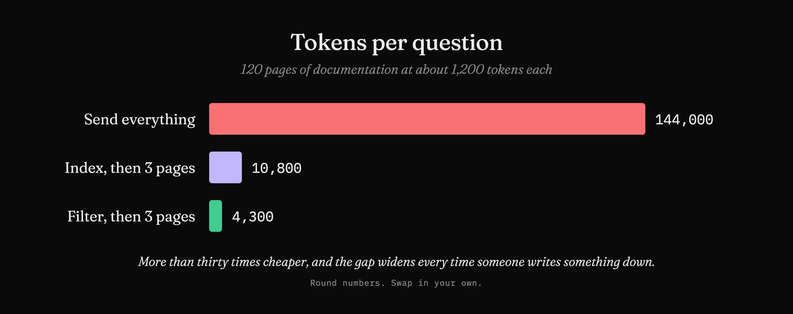

*Remember coming home from holiday to a phone bill bigger than the holiday? AI is heading for the same moment. The fix is mostly arithmetic.*

## Bill shock

Every summer in the late 2000s brought the same story. Someone went to Spain, used their phone the way they did at home, and came back to a bill for hundreds of pounds.

Nobody had done anything wrong. They just could not see the meter running.

It took years of regulation to fix. Roaming charges inside the EU were finally scrapped in 2017. The lesson outlived the fix. **When the meter is invisible, people use the thing as if it were free, right up until the invoice arrives.**

Every call to a language model is metered. The unit is the token, roughly three quarters of a word. You pay for every token you send and every token you get back. In a demo with ten documents, nobody notices. In production, the meter never stops.

Earlier in this series I wrote about a leaderboard that ranked engineers by how many tokens they burned. That is the roaming bill turned into a game. The goal was never more tokens. It is fewer tokens per problem solved.

## Reading is cheap, writing is dear

The two directions are not priced the same, and Chip Huyen's *AI Engineering* explains why.

A model reads your whole prompt at once, in parallel. That step is called prefill. It writes its answer one token at a time, each waiting for the one before. That step is called decode.

So output is slower than input, and usually priced higher. A long answer costs you twice: once on the invoice, once in waiting.

## The window is a budget

Every call has a context window: the model's working memory for that one request. Everything it can consider has to fit inside. Your instructions, your documents, the question, and room for the answer.

That makes the window a budget. And like any budget, the interesting question is where it goes.

The naive design puts everything in. "Here's the whole handbook, now answer the question." It works beautifully in the demo, because the demo handbook has ten pages.

## The arithmetic

Round numbers. Swap in your own.

Say a page of operational documentation is about 1,200 tokens and you have 120 pages.

**Send everything:** about 144,000 tokens for every single question. It grows with every page you add. Somewhere past 160 pages it no longer fits in a 200,000-token window at all. At that point it is not expensive. It is broken.

**Send an index, then three pages:** keep a one-line summary of each page, let the system pick the three that matter, and send only those. About 10,800 tokens. As you write more down, only the index grows.

**Filter, then three pages:** narrow the index by service and symptom before the model sees it. About 4,300 tokens, and it barely moves however much you add.

That is more than thirty times cheaper, and the gap widens every time someone documents something. **Retrieval is not an optimisation you add later. It is what makes the whole thing work.**

## Less is better, not just cheaper

There is a quality argument too.

Research by Nelson Liu and colleagues, which Huyen covers, found models are much better at using information at the start and end of a long prompt than in the middle. They called it "lost in the middle". Stuffing the window does not just cost more. It can make the answer worse, because the one paragraph that mattered ends up buried.

So spend the budget carefully. Short, stable instructions. The question, with personal details removed. A few whole, relevant documents, split at their headings rather than chopped into random chunks. And room for the answer, because a cut-off answer is worse than a shorter question.

## Four habits

**Cache the bit that never changes.** Most providers will cache a stable opening, such as your instructions and your index, so you stop paying full price to resend it. Chi Wang and Peiheng Hu describe the server side of the same trick in *Hands-On LLM Serving and Optimization*, where it is called prefix caching. Put the stable part first and the changing part last, and you get it almost free.

**Count in code, not in the model.** Do not hand a model ten thousand log lines and ask what is going on. Group and count them with ordinary code, then pass on the summary. Code is cheaper, faster, and does not hallucinate a number.

**Cap the loops.** An agent works in a loop: think, use a tool, check, repeat. A loop with no limit on steps or spend will one day run all night. Treat a runaway agent like any other incident.

**Measure cost per outcome.** Cost per call is a vanity metric. What matters is what it cost to fix the problem, including the calls that went nowhere. One expensive call that gets it right first time can beat five cheap ones that do not.

## Rented by default is the expensive default

In an earlier essay I argued for portable models by default and rented frontier models for the hard problems. The token bill is where that stops being a philosophy and becomes a budget line.

Most of what an operations team asks a model to do is not hard. Classify this ticket. Summarise this thread. Find the right page. A small model or a cheap tier does it well. Keep the big, pricey models for the questions that need them and send everything else downhill.

## Read the meter

The roaming bill did not end because people learned self-control. It ended because the meter became visible and the pricing changed.

AI will go the same way. The teams that come out well will be the ones who could always see their meter: what a typical question costs, what a fixed problem costs, and which part of the context they are paying for and why.

Know your number before the invoice tells you.

---

*Further reading: Chip Huyen, AI Engineering (O'Reilly, 2025), chapters 2, 5 and 9. Nelson F. Liu et al., ["Lost in the Middle: How Language Models Use Long Contexts"](https://arxiv.org/abs/2307.03172) (2023). Chi Wang and Peiheng Hu, Hands-On LLM Serving and Optimization (O'Reilly, 2026). European Commission, ["Roam like at home"](https://digital-strategy.ec.europa.eu/en/policies/roaming) (2017).*
