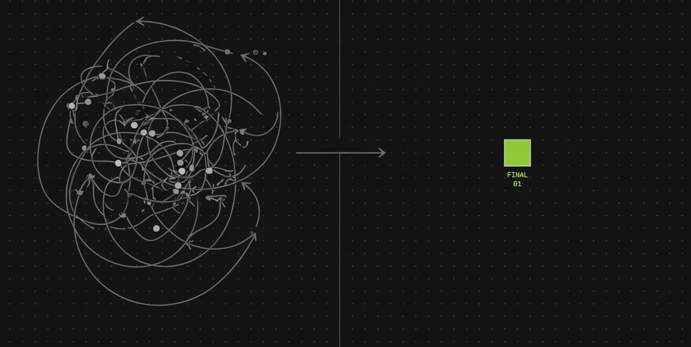
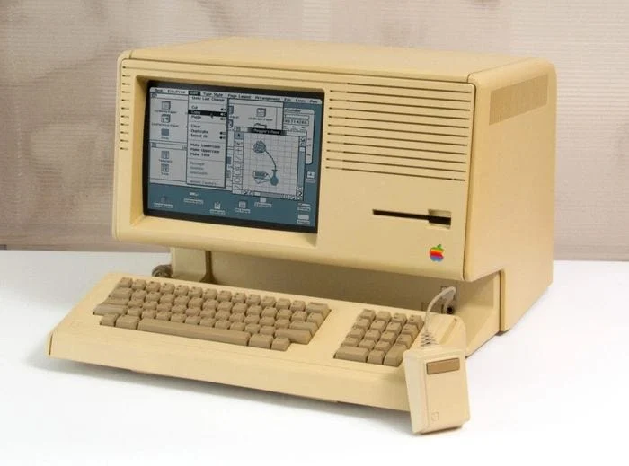
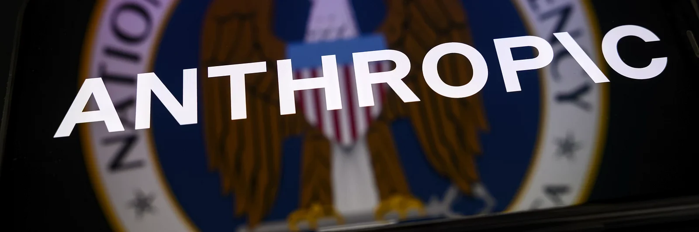
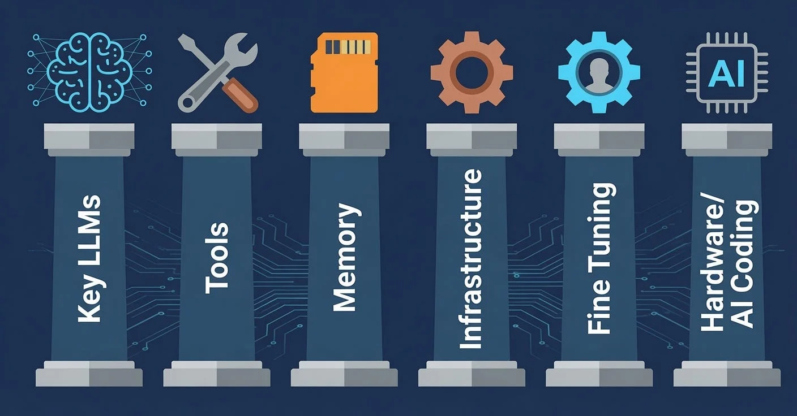

Just recently, there was a leaderboard at Meta that ranked engineers by how many AI tokens they burned. Some people climbed it doing real work. Others left agents looping overnight, producing nothing, purely to move up the board. This metric was never *quality*. It was **volume**. And the moment **volume** became the target, volume is what people made.

Scroll **LinkedIn** for ten minutes and you get the retail version. The same five people posting the same breathless thread about the same model update *GPT 5.5, Opus 4.8*.Everything **must** be new.Velocity as identity. Activity as expertise.

Andy Grove ran Intel on the opposite rule. Measure output, not activity. A token leaderboard measures activity. It is busy-ness wearing a medal.

## We have measured this before

In 1982 the Lisa team at Apple decided to track productivity by lines of code. Every Friday, engineers filed a form with a number on it.

Bill Atkinson, who wrote QuickDraw and most of the interface, had just rewritten the region engine. Six times faster, two thousand fewer lines. On the form, he wrote -2000.

They stopped asking him to fill in the form.

_*The Lisa operating system comprising approximately 90,000 lines of code*_

The Lisa shipped slow, clunky, and priced near ten thousand dollars. It flopped. The metric did not sink it alone, but it pointed in exactly the wrong direction, and the product wore the result.

Lines of code. Tokens burned. Same mistake, new units.

## The market is optimising for the wrong thing

Today’s AI market runs on volume and velocity, not value. Meta’s leaderboard is already gone, quietly pulled. Uber reportedly burned its entire 2026 token budget in four months. Salesforce expects an Anthropic bill near three hundred million dollars this year, and its CEO is now asking out loud for something that just sends the easy jobs to cheaper models.

None of it is free. Tokens cost money, they cost energy, and the hardware behind them sits in a strained supply chain. So the story around it, the threads, the launches, the demos, gets louder, more fragmented, and more complicated than the thing actually is. Complexity is the pitch.

Here is the tell. Earlier this year Anthropic called its Mythos model too dangerous to release widely, too good at finding security flaws. When Daniel Stenberg, who maintains curl, finally got a scan, it claimed five confirmed vulnerabilities. His team checked. One held up, low severity. The rest were false positives or a minor bug. His verdict was blunt: mostly marketing. His [write-up](https://daniel.haxx.se/blog/2026/05/11/mythos-finds-a-curl-vulnerability/) is worth your time.

The part the hype skips is the honest one. AI code analysis is genuinely good now. It is just not the revolution each press cycle sells, and treating every increment as a breakthrough is how you end up gaming a leaderboard instead of shipping.

## Simplicity is the greatest form of sophistication

None of this means stop. Explore the frontier models. Run the tooling. Build the swarms. Adoption comes from creative use, from making things you actually care about, not from chasing a usage chart.

But spend your effort where it compounds. Learn the fundamentals properly. The model. Tooling. Memory. Infrastructure. Fine tuning. Harnessing. Hardware. AI assisted coding. Then learn to do more with less. Sharpen the prompt. Reach for the smaller model first. Configure it well. Ignore the noise selling each point release as the future arriving early.

The people topping the leaderboard are rarely the ones building anything that lasts.

**Burning the most tokens is not the skill**. Knowing which ones you actually needed is.
