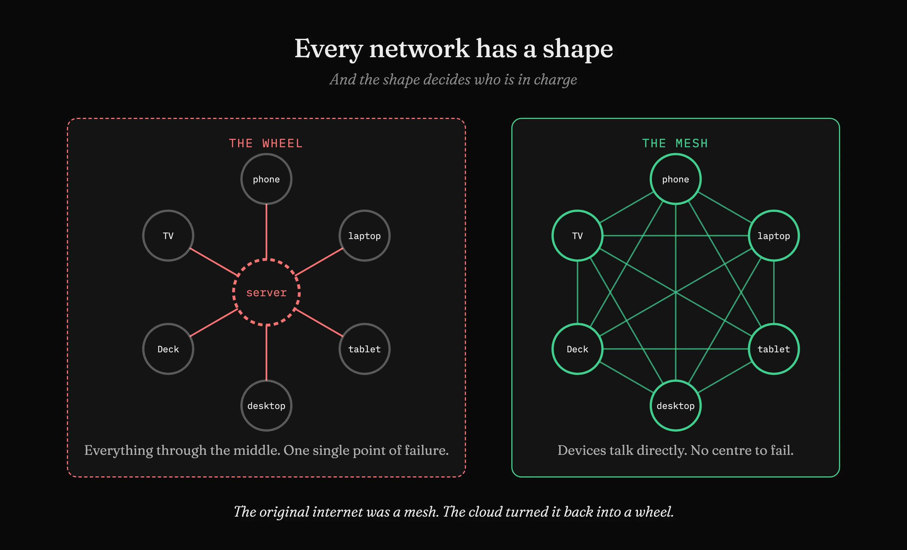

*When one Amazon data centre region failed in December 2021, people could not use their doorbells. That is what renting the plumbing looks like.*

## The day the doorbells stopped

On 7 December 2021, Amazon Web Services had a major outage in its oldest and busiest region, in northern Virginia. For several hours, a long list of things just stopped. Disney+ struggled. Payment and food-ordering apps fell over. Ring doorbells and Roomba robot hoovers stopped responding.

Read that again. **A doorbell in someone's hallway needed a data centre on the other side of the Atlantic to tell it someone had pressed it.**

The cause was mundane, as these things usually are. The effect showed how much of ordinary life now runs through a handful of buildings. Three companies, Amazon, Microsoft and Google, provide roughly two-thirds of the world's cloud infrastructure. That is efficient right up until it is not. When the landlord has a bad day, every tenant does.

## The wheel

Most of the networks we use are shaped like a wheel. Everything goes to the middle and back out.

A traditional VPN works this way. Your laptop connects to a central server. Your phone connects to the same server. If your phone wants to talk to your laptop, the traffic goes up to the middle and back down. The server is a bottleneck, a single point of failure, and a single place where everything can be watched or switched off.

It made sense when computers were big and few. It makes less sense when everyone carries several and wants them to talk to each other.

## The internet was a mesh

It is also not how the internet was meant to work.

In the early 1960s Paul Baran in the United States, and separately Donald Davies at the National Physical Laboratory in London, came up with packet switching. Break messages into small blocks and let each find its own way across a network with no single centre. Katie Hafner and Matthew Lyon's *Where Wizards Stay Up Late* tells how that became the ARPANET, and quietly takes apart the myth that it was all about surviving a nuclear war.

The original internet was a mesh. Then, as Tim Wu shows in *The Master Switch*, it did what every information industry does: it started open and drifted towards a few gatekeepers. The cloud is the latest turn of that wheel.

## The mesh

A mesh network goes back to the original shape. Devices connect directly to each other. Your phone talks to your laptop. Your laptop talks to a small home server. Every connection is encrypted end to end and takes the shortest path.

The benefits fall out of the shape. No single point of failure in the middle. Less lag, because traffic does not fly to a distant server and back. It grows naturally: add a device and you add connections, not load on a central box. And there is nothing to expose. Your devices can reach each other from anywhere without you opening ports to the whole internet.

That last one changes how you build things. A service only reachable on your private mesh does not need to face the public internet at all. **The safest door is the one that is not there.**

## Who does the introductions?

There is always a catch. Here it is.

Your data travels directly between your devices, but something still has to introduce them. Something hands out the keys, tells each device where the others are, and keeps that up to date as your phone hops between Wi-Fi and mobile data. That is the control plane. In the convenient products, the company runs it.

Tailscale is the best-known example, and I recommend it on this site for good reason. It is excellent and it gets the hard parts right. Underneath, it uses WireGuard, a small, modern, well-audited encryption protocol, for the connections. But the coordination server belongs to Tailscale. Your traffic does not go through it. Your network does depend on it.

For most people that is a perfectly sensible trade. If you want the last piece back, there are options. Headscale is an open-source rebuild of Tailscale's coordination server you can host yourself. NetBird is an open-source mesh from Germany you can run end to end. ZeroTier lets you run your own controller too.

## Don't build a new landlord

If you do host the coordinator yourself, do not swap one single point of failure for another.

Sam Newman makes the general point in *Building Resilient Distributed Systems*: the coordination services that whole systems lean on are themselves run on several machines, so losing one does not take everything down. A home-made coordinator on one box under the desk is a landlord with no spare key.

## In stages

If you want to try it, go gradually.

Start by connecting what you already have. Phone, laptop, any home server, on a managed mesh. Get used to reaching your own things from anywhere.

Then close the doors. Move anything you host behind the mesh and stop exposing it to the internet. Delete the port forwards you set up years ago and forgot about.

Only then think about taking back the coordinator, and be honest about whether the extra responsibility is worth it. Every piece of control you take back is a piece you now maintain. Running your own coordinator means it is your problem at two in the morning, not someone else's.

## The shape of things

Every network design quietly decides who is in charge. The wheel puts someone in the middle. The mesh spreads that power out to the edges, to the devices you actually own.

You do not have to run your own internet to benefit. You just have to notice the shape of the things you depend on, and ask the question that runs through this whole site: if the company in the middle had a bad day, or changed its mind, what would stop working in your house?

If the answer is "my doorbell", it might be time for a word with the landlord.

---

*Further reading: Katie Hafner and Matthew Lyon, Where Wizards Stay Up Late (Simon & Schuster, 1996). Tim Wu, The Master Switch (Knopf, 2010). Sam Newman, Building Resilient Distributed Systems (O'Reilly). AWS, [Summary of the AWS Service Event in the Northern Virginia (US-EAST-1) Region](https://aws.amazon.com/message/12721/) (December 2021).*
